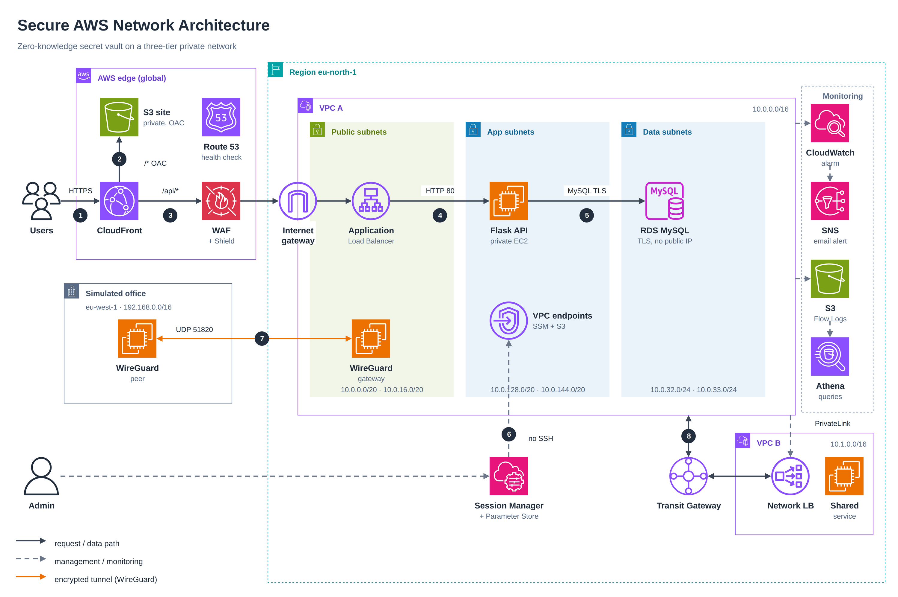
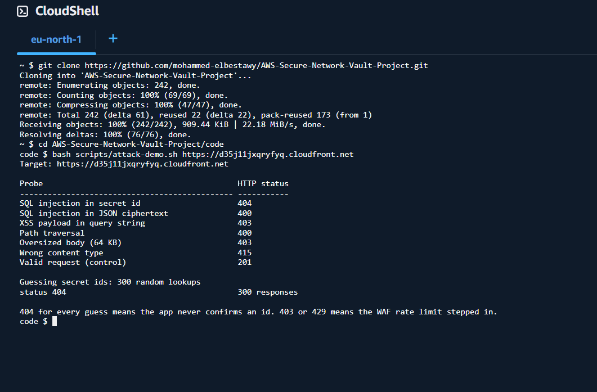

# 🔐 Secure AWS Network — Zero-Knowledge Secret Vault

A three-tier private network on AWS with edge protection, hybrid connectivity and full monitoring, running a real application: a secret-sharing service where **the server never sees the secret**. Built and tested step by step, including the faults hit along the way.


---

### Contents

- 🎯 [The Problem](#problem)
- 🏗️ [Architecture](#architecture)
- 🎬 [Demo](#demo)
- 📌 [Requirements Coverage](#requirements)
- 🧠 [The Vault](#vault)
- 🔐 [Security Decisions](#security)
- ✅ [Test Results](#test)
- 🐛 [Problems Found While Building](#problems)
- 🧩 [Skills Demonstrated](#skills)
- 💰 [Cost Decisions](#cost)
- 🚀 [Residual Risks and Improvements](#improvements)
- 📚 [Documentation](#docs)
- 📁 [Repository Structure](#structure)

---

<a id="problem"></a>
## 🎯 The Problem

A public web application is exposed to guessing, injection, scanning and credential theft. One control is never enough, so the design stacks independent layers and assumes each one can fail.

| Risk | How this project handles it |
|---|---|
| Direct access to servers or the database | App and data tiers are private: no public IP, and the data subnets have no route to the internet |
| SSH keys and open management ports | **Session Manager** over VPC endpoints: no inbound port, no key pair |
| Injection and abuse on the web tier | **WAF** managed rules and a rate rule, strict input validation, parameterised SQL |
| A server or database breach leaking secrets | Secrets are encrypted **in the browser**. The server only holds ciphertext |
| Over-privileged application | A database user with rights on one table, an IAM policy limited to four parameters |
| Lateral movement between networks | **Transit Gateway** routes and **PrivateLink** expose only what is needed |
| Not knowing something happened | **Flow Logs**, Athena, Traffic Mirroring, a CloudWatch alarm and an SNS email |

---

<a id="architecture"></a>
## 🏗️ Architecture



The editable source is [`screenshots/architecture-diagram.drawio`](screenshots/architecture-diagram.drawio) (open it in diagrams.net).

| Layer | Services | Purpose |
|---|---|---|
| Edge | CloudFront, S3 (private), WAF, Shield Standard, Route 53 | One HTTPS domain, static site from a private bucket, protection in front of the API |
| Network | VPC with three tiers, Internet gateway, NAT instance, VPC endpoints | Public ALB, private app and data, no SSH |
| Connectivity | Transit Gateway, PrivateLink, WireGuard | Hub-and-spoke between VPCs, one exposed service, tunnel to a simulated office |
| Compute | EC2 (Flask API, gateways, monitor) | Application and network functions |
| Data | RDS MySQL (TLS) | Stores ciphertext only |
| Access and secrets | Session Manager, Parameter Store, IAM | Shell without SSH, no secret in code |
| Observability | Flow Logs, Athena, Traffic Mirroring, CloudWatch, SNS | Detection and evidence |

**Request path:** User → CloudFront → (`/*` S3 · `/api/*` WAF → ALB → Flask → RDS). Admin → Session Manager → VPC endpoints → Flask. On-prem peer ⇄ WireGuard gateway. VPC A ⇄ Transit Gateway ⇄ VPC B.

Region: `eu-north-1` for the network and the application, `eu-west-1` for the simulated office.

---

<a id="demo"></a>
## 🎬 Demo

**Videos:** [Google Drive folder](https://drive.google.com/drive/folders/1DabY59yqN3LdsDXACONJj9Xtu5_08cVZ?usp=sharing)

| Video | What it shows |
|---|---|
| `demo.mp4` | The Vault website end to end: create a link, open it once, the secret is gone |
| `11-ssm-session.mp4` | Session Manager into the private server, then a check that the database answers |
| `22-waf-rate-limit.mp4` | The WAF rate limit: `200` responses turning into `403` |
| `28-incident-response.mp4` | The incident drill: isolation, evidence snapshot, recovery |

The project was deployed on AWS for the review and torn down afterwards, so the videos and the screenshots in [`screenshots/`](screenshots/) document the live run.

---

<a id="requirements"></a>
## 📌 Requirements Coverage

| Stage | Required | Delivered | Where |
|---|---|---|---|
| 1. VPC core | VPC, subnets, route tables, IGW, NAT, SSM access, EC2, ALB, RDS, security groups, NACLs, least privilege | Three-tier VPC, NAT instance, Session Manager, ALB, RDS, SG chain, NACL per tier | [STEPS](STEPS.md#vpc-a), [CONCEPTS](CONCEPTS.md#network) |
| 2. Connectivity | Peering, endpoints, PrivateLink, Transit Gateway, Site-to-Site VPN, Client VPN, Direct Connect, routing tests | All built except the VPN trio: WireGuard tunnel to a simulated office, Client VPN and Direct Connect compared | [STEPS](STEPS.md#peering), [CONCEPTS](CONCEPTS.md#hybrid) |
| 3. Edge security | CloudFront with S3, WAF, Shield, Firewall Manager, Route 53, Global Accelerator, edge tests | CloudFront, WAF rules, Shield Standard, health check, attack demo. Firewall Manager and Global Accelerator compared | [STEPS](STEPS.md#cloudfront), [CONCEPTS](CONCEPTS.md#edge) |
| 4. Monitoring and IR | Flow Logs, Traffic Mirroring, CloudWatch, Athena, compromised-instance drill | All built, plus a rehearsed isolation, snapshot and recovery | [STEPS](STEPS.md#flowlogs), [CONCEPTS](CONCEPTS.md#ir) |
| Deliverables | Diagram, CIDR plan, route tables, rules, test results, runbook, report | This README, `CONCEPTS.md` (CIDR plan, routes, runbook), `STEPS.md` (rules, tests) | |

Two deliberate substitutions, each justified in [CONCEPTS](CONCEPTS.md): a **NAT instance** instead of a NAT gateway, and **WireGuard** instead of AWS Site-to-Site VPN.

---

<a id="vault"></a>
## 🧠 The Vault

The browser encrypts, the server stores noise.

```
https://host/view.html?id=ID#KEY

ID   192 random bits, picks the record
KEY  256-bit AES key after "#", never sent to any server

create  browser: key = random(256) → AES-GCM(pad(secret)) → POST ciphertext
reveal  browser: POST /reveal → ciphertext (record deleted in the same transaction) → decrypt with KEY
```

- **Two-step open.** `GET /status` has no side effects and `POST /reveal` consumes a view, so link previews cannot burn a secret.
- **Atomic read and burn.** A locking read then delete in one transaction. A test fires 25 simultaneous reveals at one secret and exactly one succeeds.
- **Padding and limits.** Plaintext is padded to 256-byte blocks. A secret is limited to 5,000 bytes so the request body stays under the 8 KB WAF rule.
- **No inline code.** Pages use external scripts and styles only, so the CSP is `script-src 'self'; style-src 'self'`.

The browser crypto API needs a secure context, so the site is opened over HTTPS (CloudFront).

---

<a id="security"></a>
## 🔐 Security Decisions

- **Client-side encryption with the key in the URL fragment**: a server or database breach exposes nothing readable.
- **Private tiers and no SSH**: no public IP on the app or database, access only through Session Manager over VPC endpoints.
- **Chained security groups plus a NACL per tier**: two independent layers, so one mistake does not open the network.
- **Least privilege everywhere**: a database user limited to one table with TLS required, and an IAM policy limited to four parameters.
- **WAF rate rule keyed on a CloudFront-written header**: `X-Forwarded-For` is client-controlled, so a CloudFront Function writes the real viewer address into `x-client-ip` and the rule counts on that.
- **Secrets in Parameter Store**: the database password is read at start. It is never in the code, on disk or in user data.

The reasoning behind each choice is in [`CONCEPTS.md`](CONCEPTS.md).

---

<a id="test"></a>
## ✅ Test Results

```bash
python -m unittest discover -s code/tests -v     # 29 tests: API, validation, concurrency, MySQL transaction flow
node --test code/tests/crypto.test.mjs           # 10 tests: round trip, tamper, wrong key, padding, limits
bash code/scripts/smoke-test.sh http://localhost # 10 checks against a running instance
```

| Check | Result |
|---|---|
| Private server reachable only through Session Manager | ✅ |
| Egress through the NAT instance, then removed | ✅ |
| VPC A to VPC B through the Transit Gateway | ✅ |
| One service exposed through PrivateLink | ✅ |
| WireGuard tunnel up, on-prem peer reaches the private app | ✅ |
| Vault: create, reveal once, link dead afterwards | ✅ |
| WAF blocks SQLi and XSS probes, rate limit trips | ✅ |
| Rejected traffic found with Athena | ✅ |
| Compromised instance isolated, evidence kept, service recovered | ✅ |



---

<a id="problems"></a>
## 🐛 Problems Found While Building

1. **Transit Gateway: routes all correct, traffic still dropped.** Reachability Analyzer reported `SUBNET_ACL_RESTRICTION`. A TGW attachment places an ENI in the subnet, so the subnet's NACL applies. Peering does not, which is why the same rules had worked before.
2. **PrivateLink timing out with a healthy target.** The NLB's security group blocked client traffic, and Reachability Analyzer said `Reachable` because it cannot see past the endpoint.
3. **Session Manager offline.** The app security group had no outbound 443 to the VPC, and the endpoint group needed inbound 443.
4. **Subnet CIDRs not as typed.** The VPC wizard applied its defaults, so every rule was rewritten against the real CIDRs.
5. **The WAF would have blocked larger secrets.** The core rule set rejects bodies over 8 KB, so the application limit was lowered to 5,000 bytes.
6. **A rate limit on `X-Forwarded-For` can be dodged.** A CloudFront Function now writes the real viewer address into a header and the WAF counts on that.

---

<a id="skills"></a>
## 🧩 Skills Demonstrated

- Designing a three-tier VPC with layered controls and least-privilege rules
- Connecting networks three ways (peering, Transit Gateway, PrivateLink) and knowing when each fits
- Building an encrypted hybrid link and comparing it with the managed alternatives
- Protecting a web application at the edge with CloudFront, WAF and Shield, and testing the protections
- Debugging network faults methodically: AZ, route table, return route, security group, NACL, Reachability Analyzer
- Detection and response: Flow Logs, Athena, Traffic Mirroring, alarms, and a rehearsed isolation with evidence collection
- Writing an application whose server cannot read the data it stores

---

<a id="cost"></a>
## 💰 Cost Decisions

Hourly billed items are the NAT instance and its Elastic IP, Transit Gateway attachments, interface endpoints, the ALB, RDS, EC2 and the WAF. The build was done in the fewest days possible and everything was deleted afterwards. The NAT instance was chosen over a NAT gateway for the same reason and removed before the logging tests, because leaving it would make the reject tests pass for the wrong reason. The cost report is `screenshots/29-cost-report.png`.

---

<a id="improvements"></a>
## 🚀 Residual Risks and Improvements

| Risk | Next step |
|---|---|
| CloudFront to ALB uses HTTP | ACM certificate on the ALB and an HTTPS-only origin |
| The ALB can be reached directly | Limit its security group to the CloudFront prefix list |
| One NAT instance, one WireGuard gateway, single-AZ database | Managed NAT gateway, Site-to-Site VPN, Multi-AZ RDS |
| No threat-intelligence layer | GuardDuty and the WAF IP reputation list |
| Manual database password rotation | Secrets Manager rotation |
| Console-built | Terraform for the whole stack |

---

<a id="docs"></a>
## 📚 Documentation

- **[STEPS.md](STEPS.md)** — full build log with configuration details and debugging notes
- **[CONCEPTS.md](CONCEPTS.md)** — design rationale for each decision, the CIDR plan and route tables, the incident runbook

---

<a id="structure"></a>
## 📁 Repository Structure

```
AWS-Secure-Network-Vault-Project/
├── README.md
├── STEPS.md
├── CONCEPTS.md
├── screenshots/            evidence, architecture diagram (PNG and draw.io), demo video
├── iam/
│   ├── vault-instance-policy.json
│   └── README.md
└── code/
    ├── backend/            Flask API, store, validation, schema
    ├── frontend/           create, view, security and project pages (HTML, CSS, JavaScript)
    ├── deploy/             install script, systemd units, CloudWatch agent config
    ├── infra/              NAT instance, WireGuard and CloudFront function
    ├── scripts/            database bootstrap, smoke test, attack demo
    └── tests/              API, crypto, end-to-end
```

Built by Mohammed Elbestawy · [GitHub](https://github.com/mohammed-elbestawy) · [LinkedIn](https://linkedin.com/in/mohammed-elbestawy-4349a7328)
