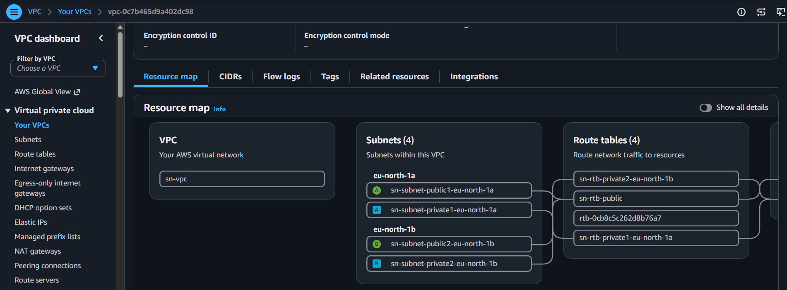
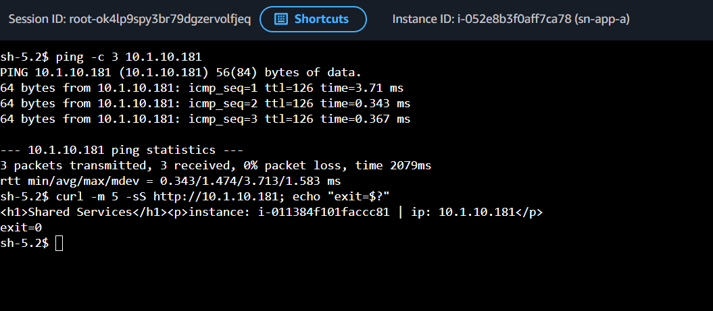
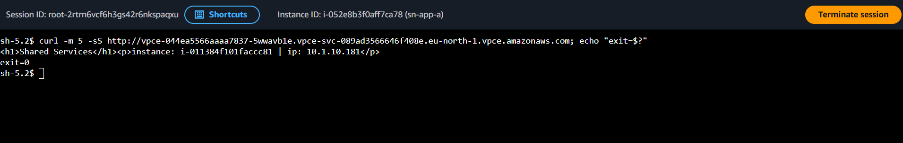
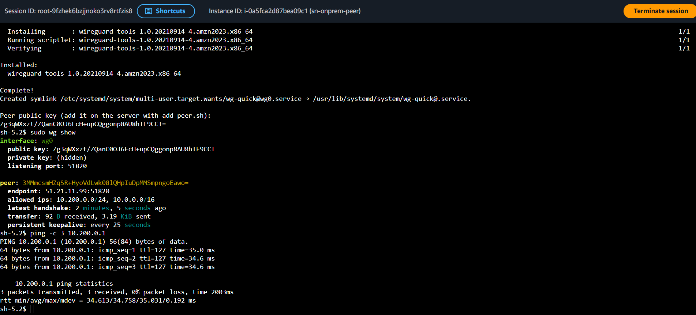
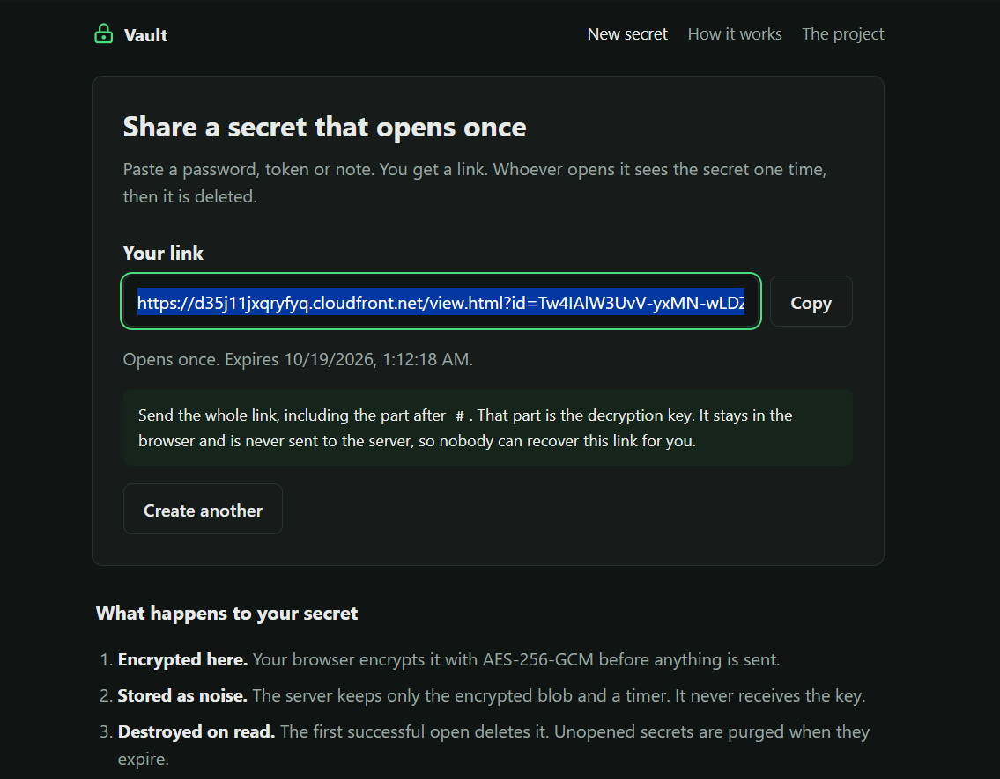
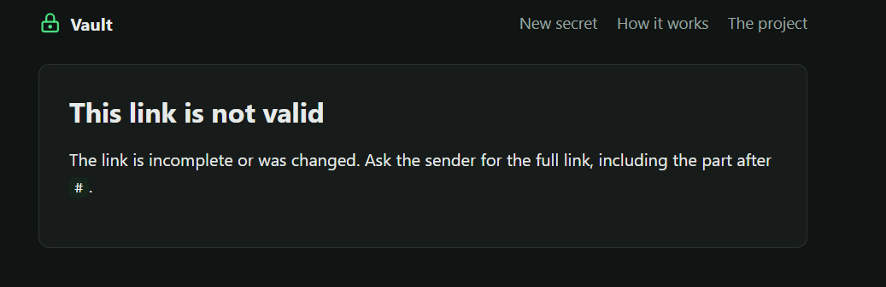
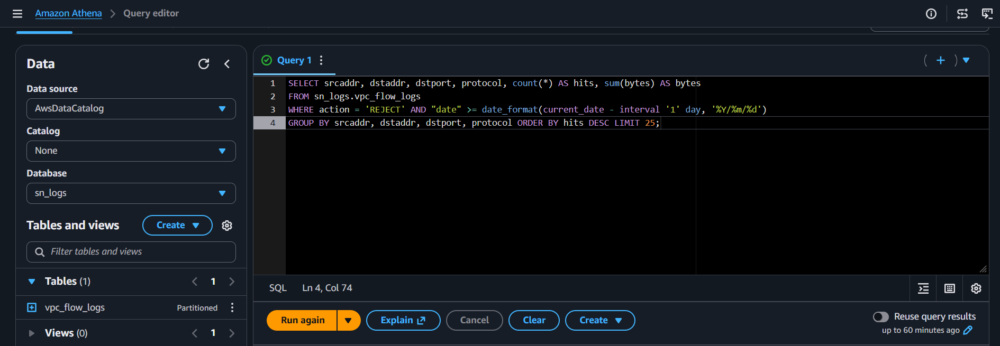
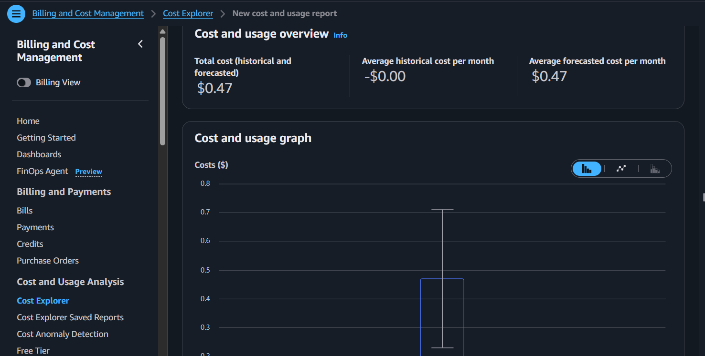

# 🛠️ Build Log — Secure Network Vault

A record of the resources created, the configuration used, and the faults that showed up while building the network and the vault on top of it.

  

---

All 30 steps are complete: the network and the vault run in `eu-north-1`, the simulated office in `eu-west-1`. Every section was built and tested in the order shown. The account is cleaned out afterwards in the order given in [Cleanup](#cleanup).

> Anything that bills by the hour is called out in its section. Names can change (`prod-vpc` instead of `sn-vpc` is fine): identify a resource by its CIDR or ID, not by its label. Cover the account ID and the email address in every screenshot before committing it.

### Contents

**🧱 Phase 1 — Foundation**
- 💰 [Region and Budget](#budget) · 🌐 [VPC A](#vpc-a) · 🗄️ [Data Subnets](#data) · 🚧 [Network ACLs](#nacls) · 🛡️ [Security Groups](#security-groups) · 🔑 [IAM Role](#iam) · 🔌 [VPC Endpoints](#endpoints)

**🖥️ Phase 2 — Compute and Data**
- 💻 [App Instance](#ec2) · ⚖️ [Load Balancer](#alb) · 🛢️ [RDS](#rds) · 🖱️ [Session Manager](#ssm) · 🚪 [NAT Instance](#nat)

**🔗 Phase 3 — Connectivity**
- 🌐 [VPC B](#vpc-b) · 🤝 [Peering](#peering) · 🚇 [Transit Gateway](#tgw) · 🔒 [PrivateLink](#privatelink) · 🏢 [On-Prem VPC](#onprem) · 🐉 [WireGuard](#wireguard)

**🔐 Phase 4 — The Vault**
- 🗝️ [Vault Database](#vault-db) · 🐍 [Flask API](#flask) · 📀 [Golden Image and NAT Removal](#golden) · 🌍 [S3 and CloudFront](#cloudfront)

**🔭 Phase 5 — Defend and Observe**
- 🧱 [WAF](#waf) · 🩺 [Route 53 and Shield](#shield) · ⚔️ [Attack and Defend](#attack) · 📜 [Flow Logs and Athena](#flowlogs) · 🪞 [Traffic Mirroring](#mirror) · 📈 [CloudWatch](#cloudwatch) · 🚨 [Incident Response](#ir)

**✅ Phase 6 — Verify and Tear Down**
- 🧪 [End-to-End Test](#e2e) · 💵 [Cost](#cost) · 🧹 [Cleanup](#cleanup)

---

## 🔎 When a Check Fails

Debug in this order: the AZ of the attachment or endpoint → the route table actually associated with the subnet → the return route in the other VPC → the security group in both directions → the NACL in both directions on any subnet that holds an ENI → Reachability Analyzer.

Test with `curl -m 5 -sS URL; echo "exit=$?"` so a failure is visible.

| Exit | Meaning |
|---|---|
| `0` | Succeeded |
| `28` | Black hole (timeout) |
| `7` | No route or a reject |
| `6` | DNS |
| `52` / `56` | Connection landed, response was empty |

---

# 🧱 Phase 1 — Foundation

<a id="budget"></a>
## 💰 Region and Budget

Everything except the simulated office runs in Stockholm.

| Setting | Value |
|---|---|
| Region | `eu-north-1` |
| Budget | Monthly cost budget, `10` USD, email notification |

---

<a id="vpc-a"></a>
## 🌐 VPC A

The main application network, built with the VPC wizard.

| Setting | Value |
|---|---|
| Name / CIDR | `sn` / `10.0.0.0/16` |
| AZs | 2 |
| Public subnets | `10.0.0.0/20`, `10.0.16.0/20` |
| Private subnets | `10.0.128.0/20`, `10.0.144.0/20` |
| NAT gateways | None |
| Gateway endpoint | S3 |
| DNS hostnames and resolution | On |

> **The wizard ignores a custom CIDR block** and applies its own defaults (the ones above). Every later rule depends on the real CIDRs, so check them before writing any NACL or security group rule.



---

<a id="data"></a>
## 🗄️ Data Subnets

A separate route table whose only route is `local`. The database has no path to the internet to misconfigure later.

| Setting | Value |
|---|---|
| Subnets | `sn-subnet-data-a` `10.0.32.0/24` (`eu-north-1a`), `sn-subnet-data-b` `10.0.33.0/24` (`eu-north-1b`) |
| Route table | `sn-rt-data`, routes: `local` only |

---

<a id="nacls"></a>
## 🚧 Network ACLs

NACLs are stateless, so return traffic needs an explicit ephemeral-port rule. Three ACLs, one per tier, replace the default allow-all on those subnets.

**`sn-nacl-public`** on `10.0.0.0/20` and `10.0.16.0/20`

| Rule | Traffic | Target |
|---|---|---|
| in 100 | TCP 80 | `0.0.0.0/0` |
| in 110 | TCP 443 | `0.0.0.0/0` |
| in 120 | TCP 1024–65535 | `0.0.0.0/0` |
| out 100 | TCP 1024–65535 | `0.0.0.0/0` |
| out 110 | TCP 80 | `10.0.128.0/19` |
| out 120 | TCP 443 | `0.0.0.0/0` |
| out 130 | TCP 80 | `0.0.0.0/0` |

**`sn-nacl-app`** on `10.0.128.0/20` and `10.0.144.0/20`

| Rule | Traffic | Target |
|---|---|---|
| in 100 | TCP 80 | `10.0.0.0/19` |
| in 110 | TCP 1024–65535 | `0.0.0.0/0` |
| out 100 | TCP 1024–65535 | `0.0.0.0/0` |
| out 110 | TCP 443 | `0.0.0.0/0` |
| out 120 | TCP 3306 | `10.0.32.0/23` |

**`sn-nacl-data`** on both data subnets

| Rule | Traffic | Target |
|---|---|---|
| in 100 | TCP 3306 | `10.0.128.0/19` |
| out 100 | TCP 1024–65535 | `10.0.128.0/19` |

> **Added later, in their own sections:**
> - Public NACL rule 140 (UDP 51820 to and from the on-prem Elastic IP) arrives with the WireGuard gateway and leaves with it.
> - App NACL, VPC B: `10.1.0.0/16` on TCP 80 and ICMP.
> - App NACL, Transit Gateway attachment ENI: `10.0.128.0/20` on TCP 80 and ICMP. This is the rule the peering path did not need.

---

<a id="security-groups"></a>
## 🛡️ Security Groups

Four groups, created empty of useful rules. The default allow-all egress is removed wherever the group should not be able to leave.

| Group | Inbound | Outbound |
|---|---|---|
| `sn-alb-sg` | HTTP from `0.0.0.0/0` | HTTP to `sn-app-sg` |
| `sn-app-sg` | HTTP from `sn-alb-sg` | HTTPS to `10.0.0.0/16`, HTTPS to the S3 prefix list, MySQL to `sn-db-sg` |
| `sn-db-sg` | MySQL from `sn-app-sg` | None |
| `sn-vpce-sg` | HTTPS from `10.0.0.0/16` | Default left in place for the endpoints |

> The wide `HTTPS 0.0.0.0/0` rule on `sn-app-sg` is added only while the NAT instance is in use, and removed before Flow Logs.

---

<a id="iam"></a>
## 🔑 IAM Role

One instance role, trusted by EC2. No key pair is created for any instance that uses it.

| Setting | Value |
|---|---|
| Role | `sn-ec2-ssm-role` |
| Trusted entity | EC2 |
| Managed policy | `AmazonSSMManagedInstanceCore` |

> The vault read policy is attached later, in [Vault Database](#vault-db). It is not part of this role yet.

---

<a id="endpoints"></a>
## 🔌 VPC Endpoints

Three interface endpoints so Session Manager works with no internet path. All three sit in the app subnet in `eu-north-1a` (the same AZ as the instance), with private DNS enabled and `sn-vpce-sg` instead of the default group. The S3 gateway endpoint already exists from the VPC wizard.

| Endpoint | Service |
|---|---|
| `sn-ssm` | `com.amazonaws.eu-north-1.ssm` |
| `sn-ssmmessages` | `com.amazonaws.eu-north-1.ssmmessages` |
| `sn-ec2messages` | `com.amazonaws.eu-north-1.ec2messages` |

> **Bills by the hour**, deleted in [Cleanup](#cleanup).
>
> **Troubleshooting:** before launching the instance, all three should be `Available`, private DNS on, in `eu-north-1a`, and on `sn-vpce-sg`. `sn-app-sg` needs outbound HTTPS to `10.0.0.0/16`. A missing piece shows up later as `dial tcp <ip>:443: i/o timeout` and a Ping status of `Offline`.

---

# 🖥️ Phase 2 — Compute and Data

<a id="ec2"></a>
## 💻 App Instance

The application server. No public IP, no key pair, IMDSv2 required, encrypted volume.

| Setting | Value |
|---|---|
| Name | `sn-app-a` |
| AMI / type | Amazon Linux 2023, `t3.micro` |
| Subnet | `10.0.128.0/20`, public IP disabled |
| Security group | `sn-app-sg` |
| Instance profile | `sn-ec2-ssm-role` |
| Metadata | V2 only |

User data writes a one-line page to `/opt/web` and serves it with `python3 -m http.server` on port 80, as `web.service`. That unit is stopped when the Flask app is installed, because both want port 80.

---

<a id="alb"></a>
## ⚖️ Application Load Balancer

Internet-facing, in both public subnets. This is the only public HTTP entry until CloudFront exists.

| Setting | Value |
|---|---|
| Name / security group | `sn-alb` / `sn-alb-sg` |
| Subnets | `10.0.0.0/20`, `10.0.16.0/20` |
| Target group | `sn-app-tg`, HTTP 80, health check `/`, VPC `sn-vpc` |
| Listener | HTTP 80 → `sn-app-tg` |

> The target has to be `Healthy`, and `http://<alb-dns>` has to return `Secure Network Lab`, before anything else depends on it.

---

<a id="rds"></a>
## 🛢️ RDS

MySQL in the data subnets only, not publicly accessible. The master password is stored by RDS in Secrets Manager and used once, to bootstrap the schema.

| Setting | Value |
|---|---|
| Identifier | `sn-db` |
| Engine / class | MySQL, `db.t3.micro`, gp3 20 GiB |
| Subnet group | `sn-db-subnets` on `10.0.32.0/24` and `10.0.33.0/24` |
| Public access / security group | No / `sn-db-sg` |
| Initial database | `appdb` |
| Credentials | Managed in Secrets Manager |
| Backup | 1 day |

---

<a id="ssm"></a>
## 🖱️ Session Manager

Connect to `sn-app-a` from the console. No SSH client, no key.

```bash
curl -s localhost
timeout 3 bash -c '</dev/tcp/DB_ENDPOINT/3306' && echo DB_REACHABLE
```

`localhost` returns the lab page and the database check returns `DB_REACHABLE`.

> `DB_ENDPOINT` is the real RDS endpoint. Pasting the placeholder produces `Name or service not known`, which looks like a DNS problem and is not one.
>
> **Troubleshooting:** if Ping status stays `Offline`, recheck the three endpoints before rebooting the instance. An old error can sit in "Latest error messages" for hours. `Missing credentials in config` is a stale browser tab: sign out and back in.

> ▶ **Video:** [Session Manager shell](screenshots/11-ssm-session.mp4)

---

<a id="nat"></a>
## 🚪 NAT Instance

The private instance has no internet. This instance gives it some, outbound only, long enough to install packages. It is an instance rather than a NAT gateway so the forwarding and the masquerade are visible, and so the hourly cost stays on a `t3.micro`.

| Setting | Value |
|---|---|
| Instance | `sn-nat-a`, Amazon Linux 2023, `t3.micro`, public subnet `10.0.0.0/20` |
| Security group | `sn-nat-sg`, inbound HTTP and HTTPS from `10.0.128.0/19` |
| Source/destination check | Stop |
| Address | Elastic IP, associated to the instance |
| Route | `0.0.0.0/0` → `sn-nat-a` on the route table of `10.0.128.0/20` |
| App egress | `sn-app-sg` outbound HTTPS to `0.0.0.0/0`, added for this window only |

User data enables `iptables`, turns on `net.ipv4.ip_forward`, and masquerades `10.0.0.0/16`. The same script is in [`code/infra/nat-instance-userdata.sh`](code/infra/nat-instance-userdata.sh).

Before the NAT exists, `curl https://checkip.amazonaws.com` from the app instance prints `NO INTERNET`. After the route is in place it returns the NAT Elastic IP.

> **Troubleshooting:** a timeout here is almost always source/destination check still on, the route on the wrong table, or `MASQUERADE` missing from `iptables -t nat -L POSTROUTING -n`. The public and app NACLs already allow 80, 443, and ephemeral ports.

**Remove after the vault is installed and before Flow Logs, in this order** (done in [Golden Image and NAT Removal](#golden)). The vault install needs this egress for `git` and `pip`, so the NAT stays until then. The route and the wide HTTPS rule have to go even if the instance itself is left up for a demo, because leaving them makes the later reject-traffic test pass for the wrong reason.

1. Delete `0.0.0.0/0` from the app route table.
2. Delete `HTTPS 0.0.0.0/0` from `sn-app-sg`.
3. Terminate `sn-nat-a`, release its Elastic IP, delete `sn-nat-sg`.

---

# 🔗 Phase 3 — Connectivity

<a id="vpc-b"></a>
## 🌐 VPC B

A second network, used as shared services. One private instance, no IAM role, serving a page that says `Shared Services`.

| Setting | Value |
|---|---|
| VPC | `sn-vpc-b`, `10.1.0.0/16` |
| Subnet | `sn-b-private-a`, `10.1.10.0/24`, `eu-north-1a` |
| Instance | `sn-shared-b`, Amazon Linux 2023, `t3.micro`, no public IP |
| Security group | `sn-b-sg`, HTTP and ICMP from `10.0.0.0/16`, HTTP from `10.1.0.0/16` |

> The peering and PrivateLink checks look for the string `Shared Services`. Reusing the VPC A user data makes a working test look failed.

---

<a id="peering"></a>
## 🤝 VPC Peering

The simple path between the two VPCs. It is built, tested, and then deleted so the Transit Gateway is the only path.

| Setting | Value |
|---|---|
| Rules added | `sn-app-sg` outbound HTTP and ICMP to `10.1.0.0/16`; `sn-nacl-app` inbound and outbound TCP 80 and ICMP for `10.1.0.0/16` |
| Connection | `sn-peering-a-b`, requester `sn-vpc`, accepter `sn-vpc-b`, same account and region |
| Route in A | `10.1.0.0/16` → peering, on the route table of `10.0.128.0/20` |
| Route in B | `10.0.0.0/16` → peering, on the main route table |

From `sn-app-a`, `ping` and `curl` to the private IP of `sn-shared-b` both succeed, and the body is `Shared Services`. The peering routes are then deleted, and the connection after them, before the Transit Gateway is created.

---

<a id="tgw"></a>
## 🚇 Transit Gateway

A hub instead of a mesh of peering connections. Default route table association and propagation are left on.

| Setting | Value |
|---|---|
| Gateway | `sn-tgw` |
| Attachment A | `sn-tgw-attach-a` on subnet `10.0.128.0/20` |
| Attachment B | `sn-tgw-attach-b` on `sn-b-private-a` |
| Route in A | `10.1.0.0/16` → `sn-tgw` |
| Route in B | `10.0.0.0/16` → `sn-tgw` |

The gateway route table should show both CIDRs as propagated.

> **The fault: everything correct, ping still 100% loss.** With every attachment, association, propagation, and route correct, `ping` showed `100% packet loss` and `curl` exited `28`. Reachability Analyzer reported `SUBNET_ACL_RESTRICTION` on `sn-nacl-app`. The attachment ENI lives in `10.0.128.0/20`, so that NACL applies. Peering never placed an ENI, which is why the same traffic worked before.
>
> **Fix:** inbound TCP 80 and ICMP from `10.0.128.0/20` on `sn-nacl-app`. After that rule, the same ping and curl succeed.

The gateway can stay until the WireGuard cleanup, since nothing after PrivateLink depends on it. **It bills by the hour** while the attachments exist.



---

<a id="privatelink"></a>
## 🔒 PrivateLink

One service in VPC B, reachable from VPC A, without a route between the networks. This is the point of PrivateLink: the Transit Gateway path above is a different design and is not required for this one.

| Setting | Value |
|---|---|
| Target group | `sn-pl-tg`, TCP 80, instance `sn-shared-b`, VPC B |
| NLB | `sn-pl-nlb`, internal, `eu-north-1a` / `sn-b-private-a` |
| NLB security group | `sn-pl-nlb-sg`, HTTP from `10.0.0.0/16` |
| Endpoint service | `sn-pl-service`, acceptance not required, principal `arn:aws:iam::ACCOUNT_ID:root` |
| Endpoint | `sn-pl-endpoint` in VPC A, subnet `10.0.128.0/20`, type "Endpoint services that use NLBs and GWLBs" |
| Endpoint security group | `sn-pl-sg`, HTTP from `sn-app-sg` |

`sn-app-sg` also needs outbound HTTP to `10.0.0.0/16`. The endpoint is in the same subnet as the instance, so `sn-nacl-app` needs no extra rule for this hop.

The check is `curl` against the **endpoint** DNS name, from `sn-app-a`. The body is `Shared Services`.

> **Two failures that looked like a healthy service:**
> 1. The console attaches a security group to the NLB, and "enforce inbound rules on PrivateLink traffic" applies it to endpoint traffic. `curl` exits `28` while the target is `Healthy` and Reachability Analyzer says `Reachable`, because the analyzer cannot see past the endpoint.
> 2. Curling the NLB DNS directly is the wrong test: the target is registered by instance ID, client IP preservation is on, and the return path is not the request path.

Deleting the endpoint, the service, the NLB, the target group, and the two security groups can wait. It is hourly cost only.



---

<a id="onprem"></a>
## 🏢 On-Prem VPC

A stand-in for an office, in a second region, so the tunnel is cross-region rather than two subnets in one VPC.

| Setting | Value |
|---|---|
| Region | `eu-west-1` |
| VPC | `sn-onprem`, `192.168.0.0/16` |
| Subnet | `sn-onprem-public`, `192.168.1.0/24`, `eu-west-1a` |
| Internet gateway | `sn-onprem-igw`, default route `0.0.0.0/0` |
| Address | Elastic IP, allocated now, associated to the peer in the next section |

---

<a id="wireguard"></a>
## 🐉 WireGuard

A UDP tunnel from the Ireland peer to a gateway in the public subnet of VPC A. The gateway masquerades `10.200.0.0/24`, so VPC resources see the gateway's private IP and need no extra route. Scripts: [`code/infra/wireguard/`](code/infra/wireguard/).

| | Gateway (`eu-north-1`) | Peer (`eu-west-1`) |
|---|---|---|
| Instance | `sn-wg-gw`, Amazon Linux 2023, `t3.micro`, subnet `10.0.0.0/20` | `sn-onprem-peer`, same AMI and size, subnet `sn-onprem-public` |
| Security group | `sn-wg-sg`, UDP 51820 from `ONPREM_EIP/32` only | `sn-onprem-sg`, UDP 51820 from `WG_EIP/32` only |
| Address | Public IP, Elastic IP (`WG_EIP`) | The Elastic IP allocated with the VPC (`ONPREM_EIP`) |
| Other | Source/destination check Stop, profile `sn-ec2-ssm-role` | |
| Setup | User data clones this repo and runs `setup-server.sh` | `setup-peer.sh` with the gateway public key and `WG_EIP` |

Then `add-peer.sh` is run on the gateway with the peer public key. The peer is the side that initiates (`PersistentKeepalive`), so the gateway only needs to know who the peer is.

Also needed on the gateway side: `sn-nacl-public` rule 140 allows UDP 51820 to and from `ONPREM_EIP/32`, inbound and outbound, and `sn-app-sg` allows inbound HTTP from `sn-wg-sg`.

**Check, from the peer:** `wg show` has a handshake under two minutes old, `ping 10.200.0.1` returns three replies, and `curl` to the app instance's private IP returns the app page.

> **Troubleshooting:**
> - **No handshake:** each security group and NACL rule 140 must allow UDP 51820 from the other Elastic IP, and `wg-quick@wg0` must be running on both sides.
> - **Handshake but `curl` exits `28`:** `sn-app-sg` is missing HTTP from `sn-wg-sg`, source/destination check is still on, or the gateway is not masquerading `10.200.0.0/24`.

Nothing from CloudFront onward depends on the tunnel, VPC B, or the Transit Gateway, so they can stay for a demo. When they go, the order is in [Cleanup](#cleanup): a VPC will not delete while a Transit Gateway attachment is still there.



---

# 🔐 Phase 4 — The Vault

<a id="vault-db"></a>
## 🗝️ Vault Database

The application connects as `vault_app`, which can touch one table. The password is read from Parameter Store at startup. It is not in the code, on disk, or in user data. `git` and `pip` need the NAT instance up for this section.

| Setting | Value |
|---|---|
| Policy | `sn-vault-ssm-read`, from [`iam/vault-instance-policy.json`](iam/vault-instance-policy.json) with `ACCOUNT_ID` replaced, attached to `sn-ec2-ssm-role` |
| Bootstrap | `bash scripts/bootstrap-db.sh DB_ENDPOINT`: prompts for the RDS master password, prints the `vault_app` password once |

Parameters:

| Name | Type | Value |
|---|---|---|
| `/vault/db/host` | String | RDS endpoint |
| `/vault/db/name` | String | `appdb` |
| `/vault/db/user` | String | `vault_app` |
| `/vault/db/password` | SecureString | The generated password |

> The policy allows `ssm:GetParameter*` on `/vault/db` and `/vault/db/*` only, and `kms:Decrypt` only when the caller came through `ssm.eu-north-1.amazonaws.com`.

---

<a id="flask"></a>
## 🐍 Flask API

Installed on the app instance with [`code/deploy/install.sh`](code/deploy/install.sh). The script stops `web.service` from the earlier lab page.

```bash
sudo bash deploy/install.sh
bash scripts/smoke-test.sh http://localhost
```

`install.sh` is done when it prints `{"status":"ok"}`, `{"status":"ok","database":"ok"}`, and `vault is running`. The target group returns to `Healthy` (the health check is still `/`, and the vault serves a page there). The smoke test ends with `passed: 10  failed: 0`.

Opening the ALB over HTTP shows the page and a warning. That warning is correct: WebCrypto will not run on plain HTTP. The full browser test waits for CloudFront, or uses a Session Manager port forward to `localhost`, which the browser treats as a secure context:

```bash
aws ssm start-session --target <instance-id> \
  --document-name AWS-StartPortForwardingSession \
  --parameters '{"portNumber":["80"],"localPortNumber":["8080"]}' \
  --region eu-north-1
```

> **Troubleshooting:** `database_unavailable` is the parameters, the policy (including a forgotten `ACCOUNT_ID`), or outbound HTTPS to the VPC plus MySQL to `sn-db-sg`. `journalctl -u vault` is the log that says which.

---

<a id="golden"></a>
## 📀 Golden Image and NAT Removal

The vault is installed by hand, so a replacement instance would come up without it. A machine image taken now makes the incident-response recovery later a one-click launch, and it needs no internet because the service reads its settings from Parameter Store at boot.

| Setting | Value |
|---|---|
| Image | `sn-app-golden`, created from `sn-app-a` after the smoke test passes |
| Then remove the NAT, in order | The `0.0.0.0/0` route from the app route table → the `HTTPS 0.0.0.0/0` rule from `sn-app-sg` → terminate `sn-nat-a` → release its Elastic IP → delete `sn-nat-sg` |
| Check | `curl -m 5 -sS https://checkip.amazonaws.com` from the app instance prints `NO INTERNET` again, and the site still works |

> From here on, anything that was rejected stays rejected, which is what the Flow Log and incident tests rely on.

---

<a id="cloudfront"></a>
## 🌍 S3 and CloudFront

The HTML, CSS, and JavaScript live in a private bucket. CloudFront is the only reader, through Origin Access Control. `/api/*` is a second origin, the ALB, so the browser sees one HTTPS host and the crypto API has a secure context.

| Setting | Value |
|---|---|
| Bucket | `sn-site-<random>`, Block Public Access on, no static website hosting |
| Objects | `code/frontend/`: `index.html`, `view.html`, `security.html`, `about.html`, `favicon.svg`, `assets/` |
| Default origin | The bucket, new OAC, viewer policy redirect HTTP to HTTPS, root object `index.html` |
| Bucket policy | The policy CloudFront offers after the distribution is created, pasted as-is |
| API origin | ALB DNS, HTTP only, port 80 |
| Behavior `/api/*` | All methods, `CachingDisabled`, origin request policy `AllViewer`, viewer protocol HTTPS only |
| Function | `sn-client-ip`, viewer request on `/api/*`, code in [`code/infra/cloudfront-client-ip.js`](code/infra/cloudfront-client-ip.js) |
| WAF on the distribution | Not enabled: the Web ACL is on the ALB |

> The function writes the real viewer address into the `x-client-ip` header, replacing anything the client sent, so the WAF rate rule cannot be dodged with a forged `X-Forwarded-For`.

Response headers policy `sn-security-headers`, attached to the default behavior:

| Header | Value |
|---|---|
| Strict-Transport-Security | `max-age=31536000` |
| X-Content-Type-Options | `nosniff` |
| X-Frame-Options | `DENY` |
| Referrer-Policy | `no-referrer` |
| Content-Security-Policy | See below |

```
default-src 'none'; script-src 'self'; style-src 'self'; img-src 'self' data:;
connect-src 'self'; base-uri 'none'; form-action 'none'; frame-ancestors 'none'
```

**Check, on `https://<domain>.cloudfront.net`:** create a secret, open the link, reveal it once, refresh, and get "This secret is gone". `GET /api/health` returns ok. `/about.html` shows the project page with the architecture diagram.

> **Troubleshooting:** POST fails if the behavior does not allow every method. A cached error sticks around if the cache policy is not `CachingDisabled`. The origin stays HTTP because the ALB listener is port 80 only; an ACM certificate on the ALB is the follow-up, not a step in this build.
>
> **Optional hardening:** a tighter ALB security group with inbound HTTP from the managed prefix list `com.amazonaws.global.cloudfront.origin-facing` instead of `0.0.0.0/0`. That list consumes a lot of rules. If it is applied, the WAF checks below have to run against the CloudFront domain, not the ALB DNS.





---

# 🔭 Phase 5 — Defend and Observe

<a id="waf"></a>
## 🧱 WAF

A regional Web ACL on `sn-alb`.

| Setting | Value |
|---|---|
| Name / resource | `sn-alb-waf` / `sn-alb` |
| Default action | Allow |
| Managed rules | AWS Core rule set |
| Rate rule | `RateLimitPerIP`, 100 requests per 5 minutes, block, evaluated before the core set |
| Aggregation | IP address in header `x-client-ip` (set by the CloudFront Function), fallback `Match` |

> **Cost:** there is no free tier. Delete the Web ACL when it is not being demoed.
>
> **Why the header aggregation matters:** the ALB's connecting IP is a CloudFront edge, so a source-IP rate limit would throttle the edge or no one. Keying on `X-Forwarded-For` is not enough either: a client can send its own value and the first address in the header is theirs. The CloudFront Function overwrites `x-client-ip`, so the value the WAF counts on is always the real viewer address.
>
> **Body size:** the core rule set rejects request bodies over 8 KB. The vault limits a secret to 5,000 bytes (about 6.9 KB of request body), so legitimate requests pass.

**Check, against the CloudFront domain:** 250 requests to `/api/health` produce `200` and then `403`. A query of `?q=<script>alert(1)</script>` is `403`. Sampled requests in the Web ACL confirm the blocks. If the rate rule never trips, check that the function is attached to `/api/*` as a viewer request and that the origin request policy is `AllViewer`.

> ▶ **Video:** [WAF rate limit](screenshots/22-waf-rate-limit.mp4)

---

<a id="shield"></a>
## 🩺 Route 53 and Shield

A health check on the ALB, and a confirmation that Shield Standard is already on. Standard is not a separate resource to create.

| Setting | Value |
|---|---|
| Health check | `sn-alb-health`, HTTP, ALB DNS, port 80, path `/` |
| Interval / threshold | 30 seconds, 3 failures |
| Shield | Standard, automatic |

---

<a id="attack"></a>
## ⚔️ Attack and Defend

[`code/scripts/attack-demo.sh`](code/scripts/attack-demo.sh) sends common probes at **this** deployment only.

```bash
bash scripts/attack-demo.sh https://<domain>.cloudfront.net
```

| Probe | Expected |
|---|---|
| SQL injection in the id or the JSON | `403` from WAF, or `400` / `404` from the app |
| XSS in the query | `403` or `404` |
| Path traversal | `400` or `404` |
| Oversized body | `413` or `403` |
| Wrong `Content-Type` | `415` |
| A valid create (control) | `201` |
| 300 guessed ids | All `404`, then `403` or `429` once the rate limit trips |

> **Defense in depth:** override the SQLi rule to Count and run the script again. The application still returns `400` or `404`, because validation and parameterised queries do not depend on the WAF. Put the rule back to Block afterwards.

The attack demo output is shown in the [README](README.md#test).

---

<a id="flowlogs"></a>
## 📜 Flow Logs and Athena

Flow Logs record who talked to whom, on which port, accepted or rejected. Athena queries them from S3.

> **Precondition:** the NAT default route and the `HTTPS 0.0.0.0/0` rule on `sn-app-sg` are already gone. If they are not, the incident drill in the next sections records the wrong thing.

| Setting | Value |
|---|---|
| Bucket | `sn-flowlogs-ACCOUNT_ID`, `eu-north-1`, Block Public Access on |
| Flow log | `sn-flowlogs` on `sn-vpc`, filter All, 1-minute aggregation, destination that bucket, default record format |
| Athena results | `s3://sn-flowlogs-ACCOUNT_ID/athena-results/` |
| Athena database / table | `sn_logs` / `vpc_flow_logs`, partitioned by date with partition projection from `2026/01/01` to `NOW` |

The table location template:

```
s3://sn-flowlogs-ACCOUNT_ID/AWSLogs/ACCOUNT_ID/vpcflowlogs/eu-north-1/${date}
```

Traffic is generated by refreshing the ALB URL, then waiting about ten minutes for `AWSLogs/` to appear.

Rejected traffic, and the noisiest pairs:

```sql
SELECT srcaddr, dstaddr, dstport, protocol, count(*) AS hits, sum(bytes) AS bytes
FROM sn_logs.vpc_flow_logs
WHERE action = 'REJECT' AND "date" >= current_date - interval '1' day
GROUP BY srcaddr, dstaddr, dstport, protocol
ORDER BY hits DESC
LIMIT 25;
```

```sql
SELECT srcaddr, dstaddr, sum(bytes) AS total_bytes
FROM sn_logs.vpc_flow_logs
WHERE "date" >= current_date - interval '1' day
GROUP BY srcaddr, dstaddr
ORDER BY total_bytes DESC
LIMIT 20;
```

> An empty result usually means the logs have not landed yet. Wait, refresh the ALB, run it again.

**More detection queries**

Management ports probed:

```sql
SELECT srcaddr, dstport, count(*) AS attempts
FROM sn_logs.vpc_flow_logs
WHERE action = 'REJECT' AND dstport IN (22, 3389) AND "date" >= current_date - interval '1' day
GROUP BY srcaddr, dstport
ORDER BY attempts DESC
LIMIT 20;
```

Private server trying to reach the internet (replace `APP_IP`):

```sql
SELECT from_unixtime(start) AS ts, dstaddr, dstport, action
FROM sn_logs.vpc_flow_logs
WHERE srcaddr = 'APP_IP' AND dstaddr NOT LIKE '10.%' AND "date" >= current_date - interval '1' day
ORDER BY start;
```

Everything one suspect address did:

```sql
SELECT from_unixtime(start) AS ts, srcaddr, dstaddr, srcport, dstport, protocol, action, bytes
FROM sn_logs.vpc_flow_logs
WHERE srcaddr = 'APP_IP' OR dstaddr = 'APP_IP'
ORDER BY start;
```



---

<a id="mirror"></a>
## 🪞 Traffic Mirroring

A private monitor instance receives a copy of the app instance's traffic, encapsulated in VXLAN on UDP 4789. Flow Logs find the event, the packets explain it.

| Setting | Value |
|---|---|
| Instance | `sn-monitor`, Amazon Linux 2023, `t3.micro`, subnet `10.0.128.0/20`, no public IP |
| Security group | `sn-monitor-sg`, inbound UDP 4789 from `10.0.0.0/16`; outbound HTTPS to the VPC and to the S3 prefix list; no allow-all egress |
| Target | `sn-mirror-target`, the monitor's network interface |
| Filter | `sn-mirror-filter`, accept all protocols, `0.0.0.0/0` to `0.0.0.0/0`, both directions |
| Session | `sn-mirror-session`, source is the ENI of `sn-app-a`, session number `1` |

On the monitor, `tcpdump -i any -nn -c 30 'udp port 4789'` prints VXLAN lines while the ALB URL is refreshed.

---

<a id="cloudwatch"></a>
## 📈 CloudWatch

An alarm on unhealthy targets, emailed through a new SNS topic, and a small dashboard.

| Setting | Value |
|---|---|
| Alarm | `sn-alb-unhealthy`: metric `UnHealthyHostCount` for `sn-app-tg`, maximum, 1 minute, greater than 0 |
| Topic | `sn-alerts`, email subscription confirmed |
| Dashboard | `sn-vault`: ALB `RequestCount`, `HTTPCode_Target_5XX_Count`, `UnHealthyHostCount`, and WAF `BlockedRequests` for `sn-alb-waf` |

---

<a id="ir"></a>
## 🚨 Incident Response

The scenario is that `sn-app-a` is scanning and trying to leave the network.

> **Precondition:** the NAT route and the wide HTTPS rule are already gone, or the outbound `curl` will succeed and Athena will not show a `REJECT`.

**1. Prepare.** Create an empty security group `sn-isolation-sg`: no inbound rules, no outbound rules.

**2. Generate the recon.** From the instance, a short loop tries a handful of ports on the data-subnet addresses and on `10.1.10.10`, then tries `https://example.com` ten times.

**3. Detect.** After about ten minutes, Athena should show one source trying more than five distinct ports:

```sql
SELECT srcaddr, dstaddr, count(DISTINCT dstport) AS ports_tried, count(*) AS attempts
FROM sn_logs.vpc_flow_logs
WHERE action = 'REJECT' AND "date" >= current_date - interval '1' day
GROUP BY srcaddr, dstaddr
HAVING count(DISTINCT dstport) > 5
ORDER BY ports_tried DESC;
```

**4. Isolate.** Security-group swap: remove `sn-app-sg`, attach `sn-isolation-sg`, tag the instance `IncidentStatus=ISOLATED`.

**5. Preserve evidence.** Snapshot the volume with `IncidentStatus=EVIDENCE` and description `IR sn-app-a` before anything is terminated. Save the console system log locally. The ALB should then return `502` or `503`, the target should go `Unhealthy`, and the `sn-alb-unhealthy` email should arrive.

**6. Recover.** Launch a new instance from the `sn-app-golden` image:

| Setting | Value |
|---|---|
| Name | `sn-app-a2` |
| Subnet / security group | The app subnet / `sn-app-sg` |
| Profile / public IP | `sn-ec2-ssm-role` / none |
| Target group | Register to `sn-app-tg` |

The vault service starts at boot and reads its settings from Parameter Store. Deregister the isolated instance. Once the snapshot is `Completed` and the new target is `Healthy`, terminate `sn-app-a`. The vault comes back, not just the lab page.

> ▶ **Video:** [Incident response drill](screenshots/28-incident-response.mp4)

---

# ✅ Phase 6 — Verify and Tear Down

<a id="e2e"></a>
## 🧪 End-to-End Test

Everything below was run against the finished build before cleanup.

| Area | Check | Result |
|---|---|---|
| Network | App instance and database have no public IP; the data route table holds only `local` | ✅ |
| Network | Session Manager reaches `sn-app-a` with no key and no internet path | ✅ |
| Network | `NO INTERNET` before the NAT instance, the NAT Elastic IP after it, and outbound HTTPS blocked again once the route and the wide rule were removed | ✅ |
| Connectivity | Peering, then Transit Gateway: `ping` and `curl` return `Shared Services` | ✅ |
| Connectivity | PrivateLink: the endpoint DNS name returns `Shared Services` with no route between the VPCs | ✅ |
| Connectivity | WireGuard: handshake under two minutes, `ping 10.200.0.1` answers, `curl` to the app private IP returns the app page | ✅ |
| Vault | Smoke test `passed: 10  failed: 0`, `/api/health` ok through CloudFront | ✅ |
| Vault | Create a secret, reveal it once, refresh: `This secret is gone` | ✅ |
| Vault | Database password read from Parameter Store only; none in code, on disk, or in user data | ✅ |
| Defence | WAF: 250 requests give `200` then `403`; the XSS query gives `403` | ✅ |
| Defence | `attack-demo.sh`: every probe blocked or rejected; with the SQLi rule on Count the app still answers `400` or `404` | ✅ |
| Defence | Shield Standard active, Route 53 health check `Healthy` | ✅ |
| Observe | Flow Logs reach S3; Athena shows `REJECT` rows and top talkers | ✅ |
| Observe | Traffic Mirroring: VXLAN lines on `sn-monitor` | ✅ |
| Observe | Unhealthy-target alarm emailed; project page `/about.html` loads from CloudFront | ✅ |
| Response | Incident drill: recon found in Athena, instance isolated, evidence snapshot `Completed`, replacement `Healthy` | ✅ |

---

<a id="cost"></a>
## 💵 Cost

Cost Explorer, last 7 days, grouped by service. The budget from the first step stayed under its `10` USD limit.

| Setting | Value |
|---|---|
| Total for the build window | `<fill from Cost Explorer>` |



---

<a id="cleanup"></a>
## 🧹 Cleanup

Anything deferred earlier goes first, or the VPC delete fails.

**Deferred items**

1. **NAT:** removed after the vault install ([Golden Image and NAT Removal](#golden)). Confirm the default route, the wide HTTPS rule, the instance, its Elastic IP and `sn-nat-sg` are gone.
2. **PrivateLink:** the endpoint, the endpoint service, the NLB, the target group, `sn-pl-sg`, `sn-pl-nlb-sg`.
3. **WireGuard, Transit Gateway, VPC B, and the Ireland VPC:**
   - Stockholm: the `10.1.0.0/16` route, both TGW attachments, `sn-tgw`, `sn-shared-b`, `sn-b-sg`, `sn-b-private-a`, `sn-vpc-b`, `sn-wg-gw` and its Elastic IP and security group, NACL rule 140, and the HTTP rule from `sn-wg-sg` on `sn-app-sg`.
   - Ireland: the peer, `ONPREM_EIP`, `sn-onprem-sg`, detach and delete the internet gateway, the subnet, then `sn-onprem`.

**Then the rest, in an order that respects dependencies**

1. Web ACL `sn-alb-waf`
2. Health check `sn-alb-health`
3. CloudFront distribution: disable, wait, delete
4. Empty and delete `sn-site-*` and `sn-flowlogs-*`
5. Parameter Store `/vault/db/*`, then detach and delete `sn-vault-ssm-read`
6. Traffic mirror session, then filter, then target
7. Terminate `sn-app-a2` and `sn-monitor`; deregister the `sn-app-golden` image and delete its snapshot
8. `sn-alb`, then `sn-app-tg`
9. `sn-db` with no final snapshot, then `sn-db-subnets`
10. The three SSM interface endpoints
11. Delete `sn-vpc`
12. The evidence snapshot, SNS topic `sn-alerts`, alarm `sn-alb-unhealthy`, dashboard `sn-vault` (dashboards bill after the first three), CloudFront function `sn-client-ip`
13. Any Elastic IP left in `eu-north-1` or `eu-west-1`

> **Final check:** Tag Editor across both regions, all supported resource types, should return none of this project's resources.
